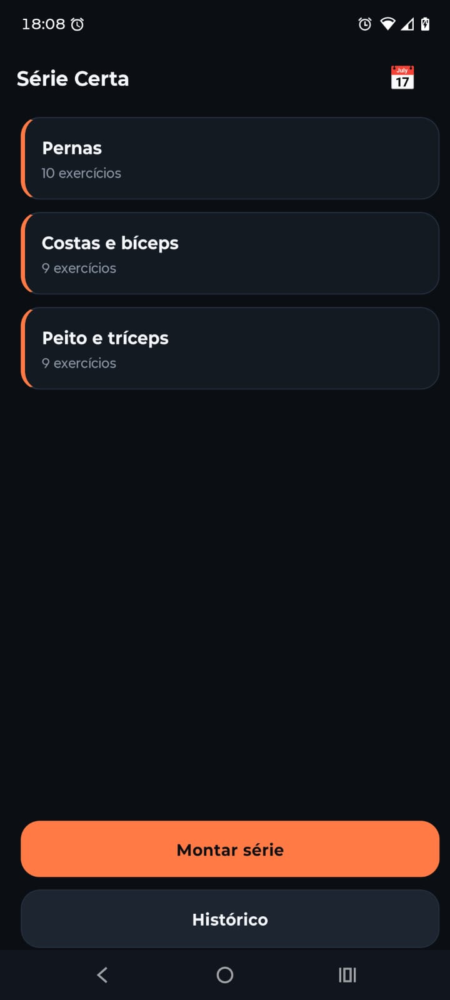
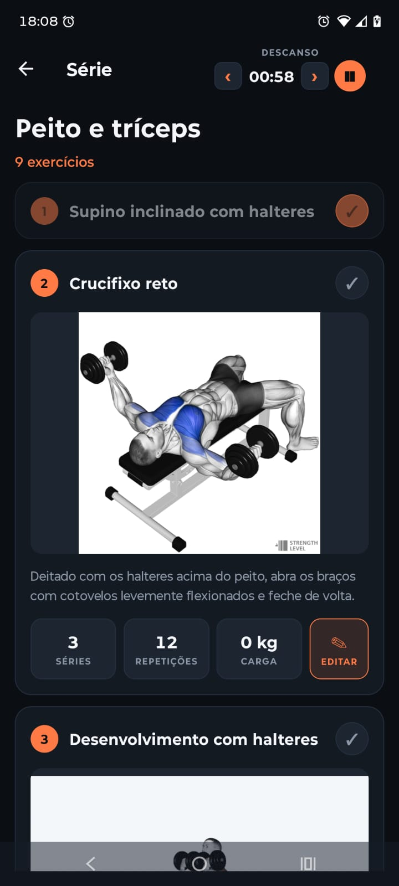
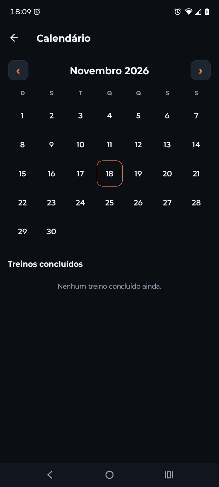

<h1 align="center">Série Certa</h1>

<p align="center">
  Monte seus treinos, acompanhe cada exercício e registre tudo no calendário.
</p>

<p align="center">
  
  
  
</p>

Aplicativo mobile para montar e acompanhar treinos de academia. Você cria suas séries de exercícios, ajusta séries, repetições e carga, usa um cronômetro de descanso e registra os treinos concluídos em um calendário.

Feito com **React Native**, **TypeScript** e **Expo**. Todos os dados ficam salvos no próprio celular, sem conta e sem servidor.

## Telas

<table align="center">
  <tr>
    <td align="center" valign="top" width="33%">
      <br />
      <b>Início</b>
      <br />
      <sub>Suas séries e o calendário</sub>
      <br /><br />
      
      <br /><br />
    </td>
    <td align="center" valign="top" width="33%">
      <br />
      <b>Treino</b>
      <br />
      <sub>Exercícios e cronômetro</sub>
      <br /><br />
      
      <br /><br />
    </td>
    <td align="center" valign="top" width="33%">
      <br />
      <b>Calendário</b>
      <br />
      <sub>Treinos de cada dia</sub>
      <br /><br />
      
      <br /><br />
    </td>
  </tr>
</table>

## Funcionalidades

- **Séries prontas:** na primeira abertura o app já vem com três séries de exemplo (Pernas, Costas e bíceps, Peito e tríceps).
- **Montar e editar séries:** escolha os exercícios por grupo muscular, com imagem e descrição. Dá para voltar e adicionar ou remover exercícios de uma série existente.
- **Cartão do exercício:** mostra imagem, descrição, séries, repetições e carga, mais um comentário opcional.
- **Edição rápida:** altere séries, repetições, carga, comentário e a posição do exercício na série.
- **Progresso no treino:** marque cada exercício como concluído e o cartão se recolhe, ficando apagado.
- **Cronômetro de descanso:** contagem regressiva com ajuste de 10 em 10 segundos, vibração ao terminar e tempo guardado em cada série.
- **Concluir treino:** o treino só pode ser concluído quando mais da metade dos exercícios estiver marcada. Caso contrário, o botão vira "Sair sem concluir".
- **Calendário:** os dias com treino concluído ficam marcados, com um popup do dia e a lista dos treinos feitos, do mais recente para o mais antigo.
- **Arquivar, desarquivar e excluir:** séries arquivadas ficam no Histórico e podem voltar ou ser apagadas de vez.

## Tecnologias

- [Expo](https://expo.dev) (SDK 58) e [Expo Router](https://docs.expo.dev/router/introduction) para navegação baseada em arquivos
- React Native 0.88 e React 19, com o React Compiler ativado
- TypeScript em modo `strict`
- [AsyncStorage](https://react-native-async-storage.github.io/async-storage/) para guardar os dados no aparelho
- [expo-image](https://docs.expo.dev/versions/latest/sdk/image/) para as imagens e GIFs dos exercícios
- [EAS Build](https://docs.expo.dev/build/introduction/) para gerar o instalável

## Como rodar

Pré-requisito: Node.js 22.13 ou superior.

```bash
npm install
npx expo start
```

No terminal do Expo, escolha onde abrir:

- **Celular:** instale o app Expo Go e leia o QR code.
- **Emulador Android:** pressione `a`.
- **Navegador:** pressione `w`.

### Comandos úteis

```bash
npx tsc --noEmit    # verifica os tipos
npx expo lint       # roda o linter
npx expo-doctor     # diagnostica dependências e configuração
```

## Gerar o instalável (Android)

O build é feito na nuvem com o EAS, sem precisar do Android Studio.

```bash
npm install --global eas-cli
eas login
eas build --platform android --profile preview
```

Ao terminar, o terminal mostra um link e um QR code para baixar o APK e instalar no celular. O perfil `preview` usa distribuição interna e está definido no `eas.json`.

## Estrutura do projeto

```
src/
  app/            Telas e rotas (Expo Router)
    index.tsx         Tela inicial, com a lista de séries
    montar.tsx        Criar e editar uma série
    historico.tsx     Séries arquivadas
    calendario.tsx    Calendário e lista de treinos concluídos
    serie/[id].tsx    Detalhe da série, onde o treino acontece
  components/     Componentes reutilizáveis (botão, cartões, cronômetro...)
  data/           exercicios.json e as séries iniciais
  styles/         Tema (cores, espaçamentos) e estilos de cada tela e componente
  types/          Tipos TypeScript (Exercicio, Treino, Conclusao)
  utils/          Armazenamento local, datas e busca de exercícios
```

Os estilos ficam separados dos componentes, em `src/styles`, e todos usam as cores e medidas do `tema.ts`. Para mudar a identidade visual do app, comece por esse arquivo.

## Como os dados são guardados

Tudo é salvo no `AsyncStorage`, em três chaves:

| Chave | Conteúdo |
| --- | --- |
| `serie-certa:treinos` | Lista de séries, com exercícios, cargas e descanso |
| `serie-certa:series-iniciais` | Marca de que as séries de exemplo já foram criadas |
| `serie-certa:conclusoes` | Treinos concluídos (data e nome), usados no calendário |

Como os dados só existem no aparelho, desinstalar o app ou limpar seus dados apaga tudo.

## Adicionar exercícios

Os exercícios ficam em `src/data/exercicios.json`. Cada item segue este formato:

```json
{
  "id": "rosca-direta",
  "nome": "Rosca direta",
  "descricao": "Em pé, flexione os cotovelos levando a barra até a altura dos ombros.",
  "img": "https://exemplo.com/rosca-direta.gif",
  "grupoPrincipal": "biceps",
  "gruposSecundarios": []
}
```

- `id` precisa ser único e é o que as séries guardam, então evite mudá-lo depois.
- `img` pode ficar vazio (`""`), e o app mostra "Sem imagem".
- Para exercícios medidos em tempo (como a prancha), adicione `"emSegundos": true`.
- Se criar um grupo novo, acrescente o nome de exibição em `NOMES_GRUPOS`, no arquivo `src/utils/exercicios.ts`.

As imagens vêm de links externos e podem deixar de funcionar com o tempo. Se algum link quebrar, o app mostra o aviso "Sem imagem" no lugar.
